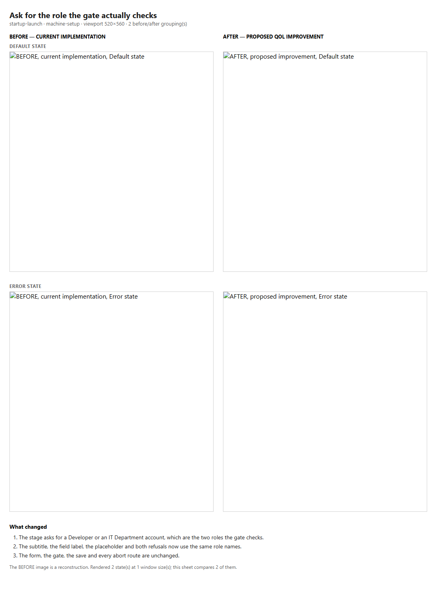

# QOL Refactor — Before and After Design

Workflow: `startup-launch` · Screen: machine setup · Refactor: `name-the-authority`

Proposed by: GitHub Copilot (proposal only) · Date: 2026-11-24 · Design record:
`name-the-authority-design.json`

**Flow source.** `startup-launch` is mapped as Diagram 5 in
[`../../../diagrams/pdf/startup-launch/diagram-startup-launch.pdf`](../../../diagrams/pdf/startup-launch/diagram-startup-launch.pdf).
This design cites sheet 1 (`u_setup`, `s_cfg`, `x_authority`); `x_authority` is the finding this proposal
answers, recorded as S1 in §6 of
[`../../../diagrams/diagram-workflow-refactor-notes.md`](../../../diagrams/diagram-workflow-refactor-notes.md).

**BEFORE is a reconstruction.** The application was not driven for this proposal: the stage appears only
when this computer has no configuration, which needs an unconfigured machine and a store. The mockup is
built from `Module_Startup/Views/MachineSetupPage.xaml`, `MachineSetupViewModel` and `MachineSetupGate`.
The real screen has not been captured.

## A. Current State

This stage is the only way a computer joins the fleet, and it is shown before anybody signs in. It asks
for an account that may configure the machine, and the gate behind it answers from one permission key:
`permission.settings.machine_configuration`, whose baseline is `role:it_department` and `role:developer`.

The screen's words do not agree with that.

| String | What it says today |
| --- | --- |
| `Startup_MachineSetup.Subtitle` | "A Developer or an **Admin** has to tell it where it stands." |
| `.SignInNameLabel` | "Developer / **Admin** user name" |
| `.SignInNameHint` | "The user name of a Developer or **Admin** account" |
| `.NotAuthorized` | "Sign in with a Developer or **Admin** account to set this computer up." |
| `.RefusedSignInRequired` | "Type a Developer or **Admin** user name and PIN before unlocking setup." |
| `.RefusedNotPermitted` | "Use an account with Developer or **IT Department** authority." |
| `.AbortSignInDeclined` | "Nobody with **IT Department** or Developer authority signed in …" |

Two of the seven already use the right name, four use a name the role catalogue retired — the permission
contract states plainly that "the retired code that must not remain in the catalogue is `admin`; the
display name that replaces it is `IT Department`" — and the same stage therefore contradicts itself
between the field label and the refusal printed under it.

The consequence is not cosmetic. A person who has to admit a new computer is told to find an Administrator.
No such role exists in `auth_roles_catalog`; the people who can help hold **IT Department** or
**Developer**, and the refusals on this very screen say so two lines later.

## B. Proposed Improvement

Every string on the stage that names the authority uses the catalogue's own two role names, **Developer**
and **IT Department**, and the subtitle says "a Developer or IT Department user" instead of "a Developer
or an Admin".

- Subtitle: "This computer has not been set up yet. A Developer or IT Department user has to tell it where
  it stands."
- Label: "Developer or IT Department user name"
- Hint: "The user name of a Developer or IT Department account"
- Refusals: `RefusedSignInRequired` and `NotAuthorized` say "Developer or IT Department".
- `RefusedNotPermitted` and `AbortSignInDeclined` already say it and are not touched.

Nothing about the gate, the form, the save, the reset or the abort routes changes. This is wording only:
the same account opens the same stage, and a person without the permission is still refused in the same
place.

## C. Visual Comparison

1. The stage asks for a Developer or an IT Department account — the two roles the gate checks.
2. The subtitle, the field label, the placeholder and the refusal now use one vocabulary instead of two.
3. The form, the gate, the save and every abort route are unchanged.

`default` is the stage before anything is typed; `state-error` is the empty-field refusal, where the old
label and the old message disagreed with the message printed underneath.

## D. Expected User Benefits

Observable, not measured:

- A person admitting a new computer asks for the right account the first time, instead of looking for an
  "Admin" account that cannot be created.
- The screen stops contradicting itself within a single glance.
- A refusal can be read back to a lead verbatim, because the name in it is a name the lead can look up.
- Support stops explaining that "Admin" and "IT Department" are the same thing.

## E. Implementation Impact

| Area | What changes |
| --- | --- |
| Resources | `Strings/en-us/Resources.resw` — the values of `Startup_MachineSetup.Subtitle`, `.SignInNameLabel`, `.SignInNameHint`, `.NotAuthorized` and `.RefusedSignInRequired` |
| View model | none: `MachineSetupViewModel` already resolves those five keys |
| XAML | none |
| Store | none |
| Navigation | none |
| Validation and business rules | none: the gate, the permission key and the abort routes are untouched |
| Regression risk | none to behaviour; the label is longer and the stage is 520 × 560, so the label and the hint were checked at that width and stay on one line |

The five key values are the whole change. No test asserts their text; the guardrails that matter here —
`InlineSqlAuditTests` and `RetiredSymbolAuditTests` — are unaffected.

## Approval

This proposal is **not approved**. Once the design is accepted, record it with
`render_mockup.py --approve --by "<name>"`; the approval hash covers the mockups, the shared assets and
the design-system XAML, and any later edit to them invalidates it.
