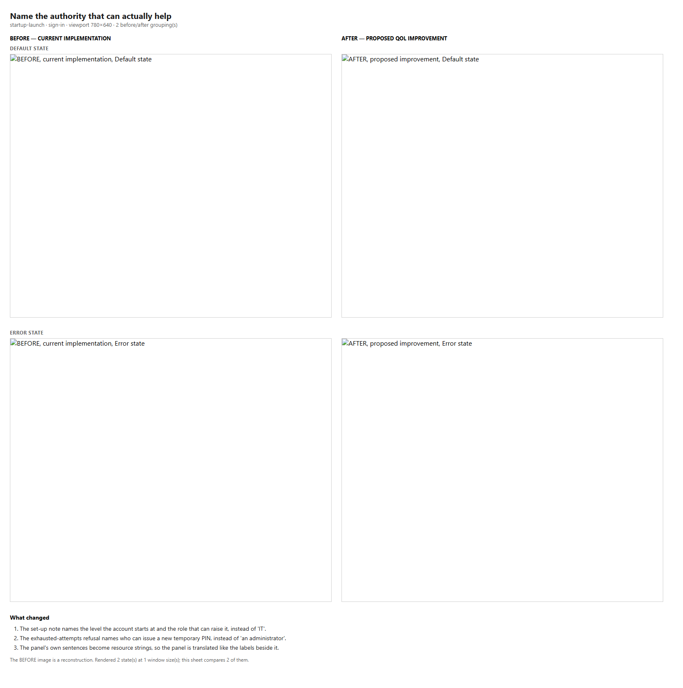

# QOL Refactor — Before and After Design

Workflow: `startup-launch` · Screen: sign in · Refactor: `name-the-authority`

Proposed by: GitHub Copilot · Date: 2026-11-24 · Approved and implemented: 2026-11-25 · Design record:
`name-the-authority-design.json`

**Flow source.** `startup-launch` is mapped as Diagram 5 in
[`../../../../diagrams/pdf/startup-launch/diagram-startup-launch.pdf`](../../../../diagrams/pdf/startup-launch/diagram-startup-launch.pdf).
This design cites sheet 2 (`v_signin`, `v_setup`). The shared finding — the startup screens name an
authority the role catalogue retired — is flagged once, as `x_authority` on sheet 1, and recorded as
S1 in §6 of
[`../../../../diagrams/diagram-workflow-refactor-notes.md`](../../../../diagrams/diagram-workflow-refactor-notes.md).

**BEFORE is a reconstruction.** The application was not driven for this proposal: the set-up panel needs
an employee number the plant system knows and the store does not, and the refusal needs five spent
attempts. The mockup is built from `Module_Startup/Views/SignInPage.xaml`,
`Module_Startup/Views/SetUpPanel.xaml`, `SignInViewModel` and `SetUpPanelViewModel`. The real screen has
not been captured.

## A. Current State

*Applied 25 November 2026 — this section records the state as it stood before the change; see §F.*

Two pieces of help text on this stage tell the person who can help, and both name somebody who cannot.

**The set-up panel's note.** It reads "A higher permission level must be requested from IT." The role
catalogue has no "IT"; the role is `it_department`, shown as **IT Department**. The note also leaves out
what the person most needs to know — `sp_core_account_setup_create` assigns the **lowest** rung of
`auth_roles_catalog` (it orders by `role_rank` and takes one row), and the panel never says so.
`AccountSetupResult.RoleCode` comes back from the creation call and is not shown anywhere.

**The exhausted-attempts refusal.** It reads "… Ask an administrator to issue a new temporary PIN." No
`admin` role exists. Issuing a temporary PIN is `permission.admin.reset_password`, held by Production
Lead, Setup Lead, Material Handler Lead, Plant Manager, IT Department and Developer — so the person is
told to ask somebody whose existence the application cannot confirm, when the terminal's own lead can
usually do it.

**The panel's own words are not translated.** `SetUpPanelViewModel` holds `HeadingText`, `NamePromptText`
and `PermissionNoteText` as literal English strings, while the seven field labels beside them resolve
`Startup_SetUp.*` keys in `SetUpPanel.xaml.cs`. The same panel is therefore translated in its labels and
untranslated in its sentences.

## B. Proposed Improvement

- The set-up note becomes "Your account starts at the lowest level. Ask IT Department." It names the
  level the account receives and the role that can raise it, in the catalogue's own vocabulary.
- The exhausted-attempts refusal ends "Ask your lead or the IT Department to issue a new temporary PIN."
  Both named parties actually hold `permission.admin.reset_password` across the roles that hold it.
- The three sentences move into `Startup_SetUp.Heading`, `.NamePrompt` and `.PermissionNote`, so the panel
  is translated like everything else on it. In English their words do not change; only the note's do.

Nothing else on the stage changes: the fields, the order the person fills them, the keyboard rules, the
offer column and the sign-in form are all untouched.

## C. Visual Comparison

1. The set-up note now says what level the account starts at and names the role that can raise it.
2. The exhausted-attempts refusal names people who hold the reset permission.
3. The panel's sentences become resource strings, so they follow the application's language.

`default` is the set-up panel; `state-error` is the refusal after five spent attempts.

## D. Expected User Benefits

Observable, not measured:

- A new person is told, before creating the account, that they start at the bottom and who can raise
  them — instead of finding out when an action is refused later.
- A person locked out by five refused PINs is pointed at their lead or the IT Department, both of which
  exist in the role catalogue, instead of at an "administrator" nobody can look up.
- The panel's sentences appear in the application's language like the labels beside them.
- Support stops receiving "who is the administrator?" for a role the catalogue retired.

## E. Implementation Impact

| Area | What changes |
| --- | --- |
| View model | `MTM_Waitlist.Startup/ViewModels/SetUpPanelViewModel.cs` — the three text properties resolve resource keys instead of literals |
| Resources | `Strings/en-us/Resources.resw` — add `Startup_SetUp.Heading`, `.NamePrompt`, `.PermissionNote`; replace the value of `Startup_SignIn.RefusedAttemptsExhausted` |
| XAML | none: `SetUpPanel.xaml` already binds the three properties, and the refusal strip already binds `ViewModel.Message` |
| Store | none |
| Navigation | none |
| Validation and business rules | none: the note is text, and the refusal is chosen by the existing code |
| Regression risk | the new note is longer than the old one and the panel is at the stage's height; it was measured to stay on one line at the 780 × 640 stage. A longer translation would wrap and push the buttons into the page's existing scroll area |

## F. Implementation Record

Applied on 25 November 2026.

- `SetUpPanelViewModel.HeadingText`, `NamePromptText` and `PermissionNoteText` now resolve
  `Startup_SetUp.Heading`, `.NamePrompt` and `.PermissionNote` instead of holding literals.
- `Strings/en-us/Resources.resw` carries the three new keys, and `Startup_SignIn.RefusedAttemptsExhausted`
  now ends "Ask your lead or the IT Department to issue a new temporary PIN."
- No XAML, store, route or validation code changed. `AccountSetupResult.RoleCode` is still not shown
  anywhere; that is a separate question from the wording.

Verified by building the solution (no warnings, no errors) and running the 428 startup tests, including
`SetUpPanelViewModelTests`, whose permission-note assertion now proves the value is a resource string
rather than the retired literal.

## Approval

**Approved** by John Koll on 25 November 2026, after the implementation in §F. The record is written in
`name-the-authority-design.json`; its hash covers the mockups, the shared assets and the design-system
XAML, so any later edit to those invalidates it.
