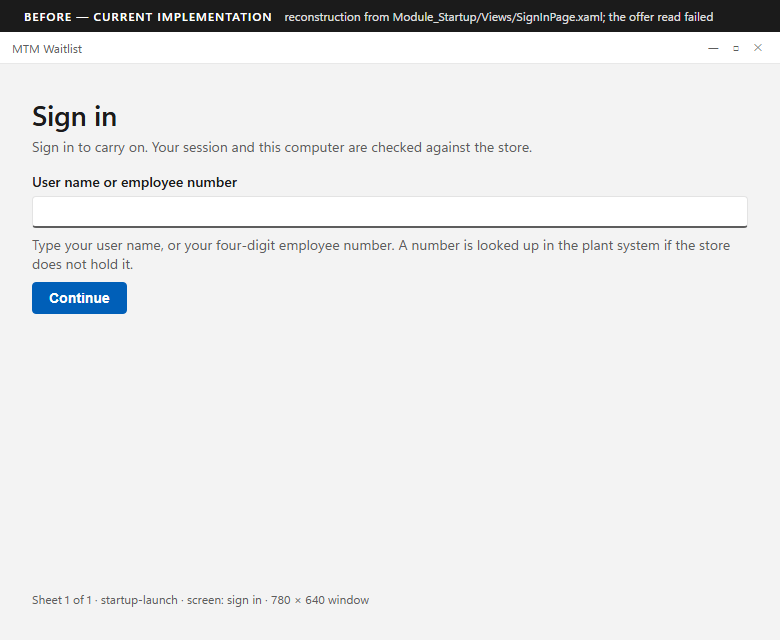
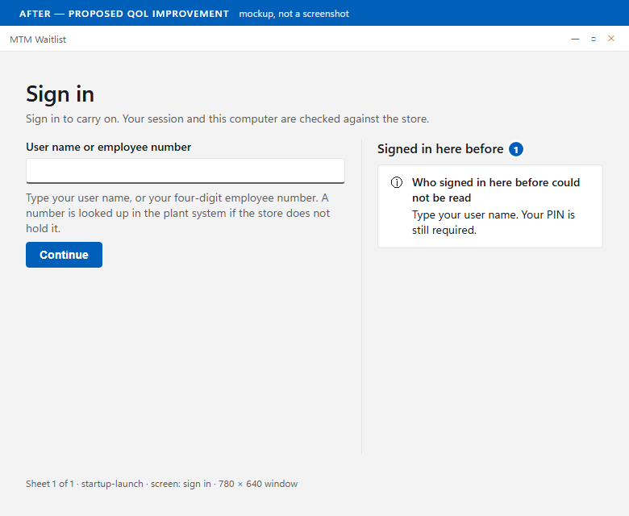

# QOL Refactor — Before and After Design

Workflow: `startup-launch` · Screen: sign in · Refactor: `no-offer-explained`

Proposed by: GitHub Copilot · Date: 2026-11-24 · Approved and implemented: 2026-11-25 · Design record:
`no-offer-explained-design.json`

**Flow source.** `startup-launch` is mapped as Diagram 5 in
[`../../../../diagrams/pdf/startup-launch/diagram-startup-launch.pdf`](../../../../diagrams/pdf/startup-launch/diagram-startup-launch.pdf):
sheet 1 is the entry and this computer, sheet 2 is signing in, sheet 3 is the stops and the hand-over.
This design cites sheet 2 (`v_signin`, `s_people`, `x_offer`) in `workflow_refs`; `x_offer` is the
finding this proposal answers. That flag now also records two neighbours found in the same read — an
offer that keeps a deactivated account, and one that never says how many people use the computer — which
`terminal-aware-offer` answers instead; the detail is in §6 of
[`../../../../diagrams/diagram-workflow-refactor-notes.md`](../../../../diagrams/diagram-workflow-refactor-notes.md).

**BEFORE is a reconstruction.** The application was not driven for this proposal: the stage needs a
configured machine and a store that fails in a specific way. The mockup is built from
`Module_Startup/Views/SignInPage.xaml`, `SignInViewModel.LoadPreviousPeopleAsync` and
`PreviousSignInService.ReadAsync`. The real screen has not been captured.

**Two sibling refactors sit on this same column.** `terminal-aware-offer` answers what the column says
about the computer it is on and stops offering accounts that can no longer sign in; `name-the-authority`
answers the stage's help text. This proposal answers what the column says when the read fails. They
compose: the note described here appears in the column that the other proposal describes, and neither
changes the other's wording.

## A. Current State

*Applied 25 November 2026 — this section records the state as it stood before the change; see §F.*

The sign-in stage offers the last six people who signed in on this computer in a column to the right of
the form, behind a divider. The stage is 780 × 640; that size exists so no name in the offer is cut off.

`PreviousSignInService.ReadAsync` catches every store failure, writes an `AppLog.Error`, and returns an
empty list (lines 56–77). `SignInViewModel.LoadPreviousPeopleAsync` clears the list, adds whatever came
back, and raises `HasPreviousPeople`, which is `PreviousPeople.Count > 0`. The XAML binds the divider and
the whole offer column to that flag.

So when the store cannot be read, the column **and its divider disappear with no explanation**. A person
who expects their name to be offered cannot tell "the list is empty" from "the list could not be read",
and the living spec's scenario only promises that the form still works — it says nothing about the
silence. Nothing on the screen, and nothing in the message strip, states the cause.

## B. Proposed Improvement

When the offer cannot be read, keep the column where it is and put a short note in it: the heading stays
("Signed in here before"), and beneath it an informational bar says the list could not be read and that
typing the user name still works. The form, the PIN stage, the refusal strip and the sign-in path are
untouched.

- Divider and column appear when there are people **or** a reason there are none.
- The note is informational, not an error: sign-in still works, so it must not read as a stop.
- The wording is a new resource key, `Startup_SignIn.PreviousPeopleUnavailable`, so it is localised like
  every other string on the screen.

## C. Visual Comparison

1. The offer column stays and says why it is empty, instead of vanishing.
2. Sign-in itself is unchanged: the form still works with the name typed by hand.

## D. Expected User Benefits

Observable, not measured:

- A person who expected to be offered their name sees a cause instead of an unexplained absence.
- The absence stops reading as "nobody has signed in here", which would suggest the wrong machine or a
  wiped record.
- No extra click: the note is text in space that is already empty.
- Support stops having to infer the failure from a log entry the person cannot see.

## E. Implementation Impact

| Area | What changes |
| --- | --- |
| XAML | `Module_Startup/Views/SignInPage.xaml` — divider and offer column bind to a new "shown" property; an `InfoBar` inside the column |
| View model | `MTM_Waitlist.Startup/ViewModels/SignInViewModel.cs` — `LoadPreviousPeopleAsync` records that the read failed; expose `IsOfferUnavailable` and a combined `ShowOffer` |
| Service | `MTM_Waitlist.Startup/Services/PreviousSignInService.cs` — report the failure instead of returning an empty list, for example `PreviousSignInResult(People, ReadOk)`; the `AppLog.Error` stays |
| Resources | `Strings/en-us/Resources.resw` — add `Startup_SignIn.PreviousPeopleUnavailable` |
| Navigation | none |
| Validation and business rules | none: no check, route or stored procedure changes |
| Regression risk | a machine with no registry row (`computerId <= 0`) must still show nothing, not the note; the note must not appear when the list is genuinely empty but readable |

The two risk cases are states the implementation must handle, not new behaviour: a readable empty list is
still an empty column.

## F. Implementation Record

Applied on 25 November 2026.

- `PreviousSignInService.ReadAsync` returns a `PreviousSignInResult` carrying the people and whether the
  store answered; the `AppLog.Error` stays, and a failed read still leaves an empty list.
- `SignInViewModel` exposes `IsOfferUnavailable` from that answer, `ShowOffer` (`HasPreviousPeople ||
  IsOfferUnavailable`) and `PreviousPeopleUnavailableText`.
- `SignInPage.xaml` binds the divider and the offer column to `ShowOffer`, and the column carries one
  `InfoBar` at `Informational` severity opened by `IsOfferUnavailable`.
- `Strings/en-us/Resources.resw` adds `Startup_SignIn.PreviousPeopleUnavailable`.

Both risk cases from §E are covered by tests: a readable empty list and a computer with no registry row
each show no column and no note, while a failed read shows the column with the note. The solution builds
with no warnings and the 428 startup tests pass.

## Approval

**Approved** by John Koll on 25 November 2026, after the implementation in §F. The record is written in
`no-offer-explained-design.json`; its hash covers the mockups, the shared assets and the design-system
XAML, so any later edit to those invalidates it.
