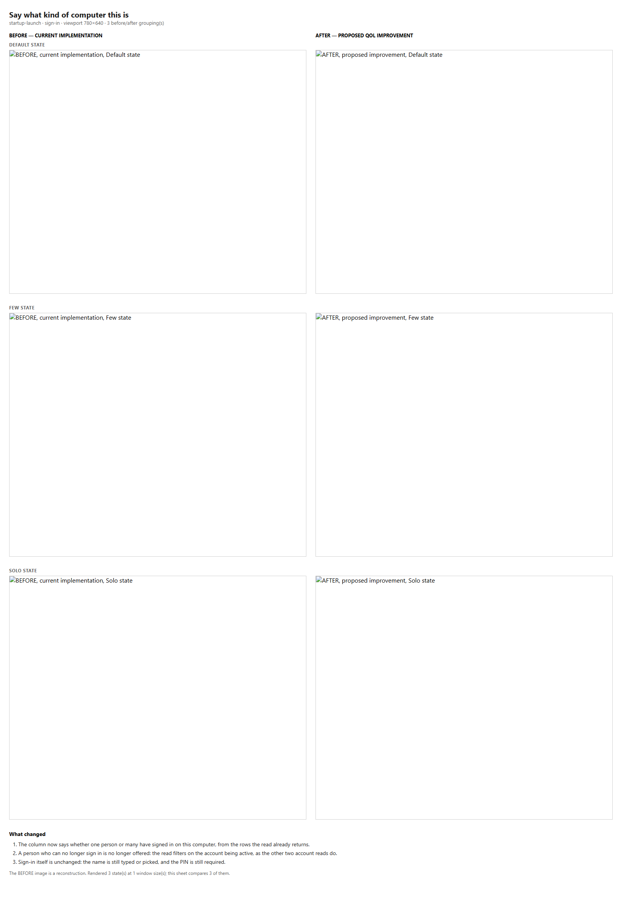

# QOL Refactor — Before and After Design

Workflow: `startup-launch` · Screen: sign in · Refactor: `terminal-aware-offer`

Proposed by: GitHub Copilot (proposal only) · Date: 2026-11-24 · Design record:
`terminal-aware-offer-design.json`

**Flow source.** `startup-launch` is mapped as Diagram 5 in
[`../../../diagrams/pdf/startup-launch/diagram-startup-launch.pdf`](../../../diagrams/pdf/startup-launch/diagram-startup-launch.pdf).
This design cites sheet 2 (`v_signin`, `s_people`, `x_offer`). `x_offer` is the finding this proposal
answers, and it now records three related defects in one flag because the sheet is at its shape ceiling;
the detail is in §6 of
[`../../../diagrams/diagram-workflow-refactor-notes.md`](../../../diagrams/diagram-workflow-refactor-notes.md).

**BEFORE is a reconstruction.** The application was not driven for this proposal: the stage needs a
configured machine whose store holds several sign-ins. The mockup is built from
`Module_Startup/Views/SignInPage.xaml`, `SignInViewModel.LoadPreviousPeopleAsync` and
`PreviousSignInService.ReadAsync`. The real screen has not been captured.

This refactor sits beside `no-offer-explained`, which answers a different defect in the same column: what
the column says when the read fails. The two are compatible and neither replaces the other.

## A. Current State

The sign-in stage offers the people who signed in on this computer before, in a column to the right of
the form behind a divider. Each card shows a display name and the sign-in name and fills in the user name
only; the PIN is always required (FR-014, FR-048).

The read behind the column is one stored procedure, `sp_auth_user_previous_sign_ins_list`. Three things
about it are visible to the person standing at the screen:

1. **It returns at most six rows, ordered most recent first, and returns no time at all.** The order is
   invisible, so six names from the previous shift look exactly like six names from five minutes ago.
2. **It does not filter on the account being active.** `sp_auth_user_credential_get` and
   `sp_auth_user_row_get` both carry `u.is_active = 1`; this read does not. A person who has been
   deactivated stays in the column on every computer they used, and their sign-in is refused on the next
   stage.
3. **Nothing says what kind of computer this is.** `core_computers_registry` holds a name, a hostname, a
   hardware address, a display name, a location and a registered flag — no assigned user and no terminal
   kind.

So one column serves two very different machines and says the same thing on both. On a computer one person
uses, it holds that one name beside a form that asks for a name anyway. On a shared terminal it holds the
six most recent of a rotating crowd, with no indication of when any of them signed in, and a person who is
not among the six still types their name.

## B. Proposed Improvement

The column states how many people have signed in on this computer, in a line under its heading, and the
read stops offering accounts that can no longer sign in.

The line is drawn from the rows the read already returns, and it is exact where it can be: the session
table holds one row per person per machine and no row is ever deleted, so fewer than six rows is the exact
number of people who have signed in here, and six rows means six or more. Three wordings cover the three
bands, so the sentence never claims a precision the read does not have:

| Rows returned | Line under the heading |
|---|---|
| 1 | One person has signed in on this computer. |
| 2–5 | Several people have signed in on this computer. Most recent first. |
| 6 | Six or more people have signed in on this computer. Most recent first. |

Everything else stays as it is. The heading keeps its wording, the cards keep their shape and their
"name only" rule, the divider still appears only when there is something to show, and the form is
untouched.

## C. Visual Comparison

1. The column now says whether this is one person's computer or a shared terminal, using data the read
   already returns.
2. A person who can no longer sign in is no longer offered.
3. Sign-in itself is unchanged: the name is typed or picked, and the PIN is still required.

The states rendered are the three bands: six or more (`default`), several (`state-few`) and one
(`state-solo`).

## D. Expected User Benefits

Observable, not measured:

- On a computer one person uses, the column says so, and the person stops wondering whether the list is
  theirs or somebody else's.
- On a shared terminal, the line says the list is a crowd and that the most recent is first, which is what
  makes a six-row list readable on a busy press.
- A deactivated account disappears from a terminal it no longer belongs to, so nobody is offered a name
  that the next stage will refuse.
- No extra click and no extra field: the line is text above a list that is already there.

## E. Implementation Impact

| Area | What changes |
| --- | --- |
| XAML | `Module_Startup/Views/SignInPage.xaml` — one `TextBlock` under the offer heading, bound to the new property |
| View model | `MTM_Waitlist.Startup/ViewModels/SignInViewModel.cs` — expose the chosen line from `PreviousPeople.Count`; raise it where `HasPreviousPeople` is already raised |
| Service | `MTM_Waitlist.Startup/Services/PreviousSignInService.cs` — nothing beyond returning the list it already returns |
| Store | `Database/StoredProcedures/sp_auth_user_previous_sign_ins_list/create.sql` — add `AND u.is_active = 1` to match the other two account reads; `rollback.sql` is unchanged |
| Resources | `Strings/en-us/Resources.resw` — add `Startup_SignIn.PreviousPeopleScopeOne`, `.ScopeFew`, `.ScopeMany` |
| Navigation | none |
| Validation and business rules | none: the column is still a convenience, and a failed read still leaves the form working |
| Regression risk | a machine with no registry row (`computerId <= 0`) still shows no column and no line; a readable empty list still shows nothing; the count is of people, not of sign-ins |

**Deliberately not designed here.** The read returns no time, so a card cannot say when that person last
used this computer. Returning `last_signed_in_utc` from the same query and showing it under the name would
answer the remaining question on a shared terminal — is the top of this list this shift or the last one?
That needs a read-shape change and a card change, so it is proposed as a follow-on rather than drawn as if
it existed.

## Approval

This proposal is **not approved**. Once the design is accepted, record it with
`render_mockup.py --approve --by "<name>"`; the approval hash covers the mockups, the shared assets and
the design-system XAML, and any later edit to them invalidates it.
